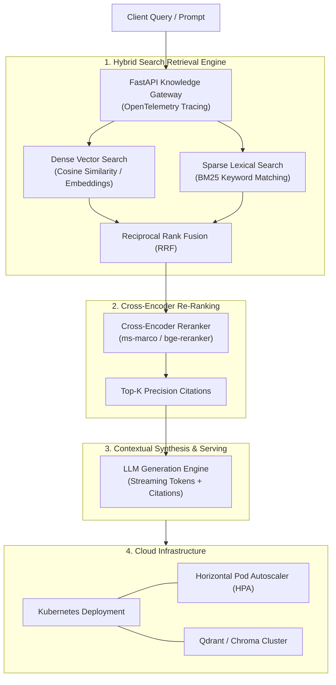

# 🧠 Production Enterprise Agentic RAG Platform

[](#)
[](#)
[](#)
[](#)

> **High-throughput, production-ready Retrieval-Augmented Generation (RAG) platform** engineered for enterprise scale, featuring sparse BM25 + dense vector hybrid search, cross-encoder reranking, FastAPI streaming API, and autoscaled Kubernetes deployment.

---

## 🏛️ System Architecture



---

## ⚡ Key Capabilities

* **Hybrid Retrieval (Dense + Sparse)**: Combines semantic nuance with exact keyword matching to eliminate hallucinations.
* **Cross-Encoder Re-ranking**: Second-stage scoring maximizes context relevance before injecting into LLM context windows.
* **OpenTelemetry Instrumentation**: Full distributed tracing of latency, vector query times, and token generation rates.
* **Production Kubernetes Topology**: Includes Deployment specs, liveness/readiness probes, and Horizontal Pod Autoscaling (HPA) up to 10 replicas.
* **Hardened Security**: Non-root UID `10001` containerized runtime following zero-trust standards.

---

## 🚀 API Specification & Local Execution

### 1. Run with Docker
```bash
docker build -t enterprise-rag-platform:latest .
docker run -p 8000:8000 enterprise-rag-platform:latest
```

### 2. Query the Hybrid RAG API
```bash
curl -X POST "http://localhost:8000/api/v1/rag/query" \
  -H "Content-Type: application/json" \
  -d '{
    "query": "What are Azure Landing Zone CAF standards for networking?",
    "top_k": 3,
    "rerank": true
  }'
```

### 3. Deploy to Kubernetes
```bash
kubectl apply -f k8s/deployment.yaml
```

---

## 👨💻 Author

**Ashu Dixit (Ashu02412)**  
*Senior DevSecOps & AI Platform Engineer*  
- GitHub: [@Ashu02412](https://github.com/Ashu02412)  
- Email: [ashu.dixit024@gmail.com](mailto:ashu.dixit024@gmail.com)
